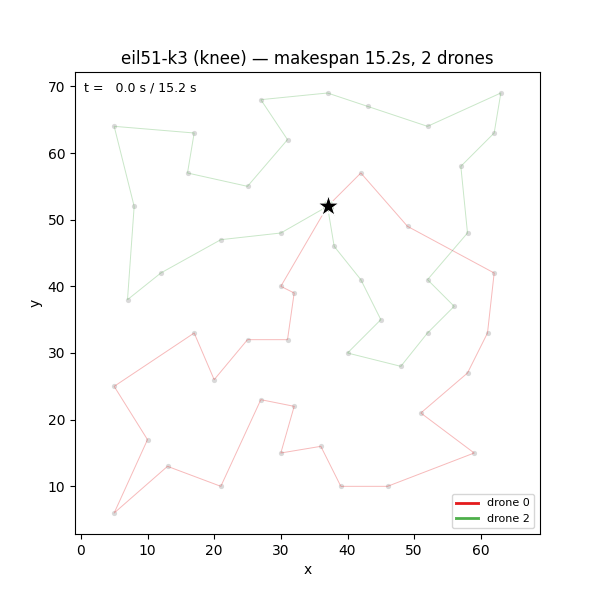
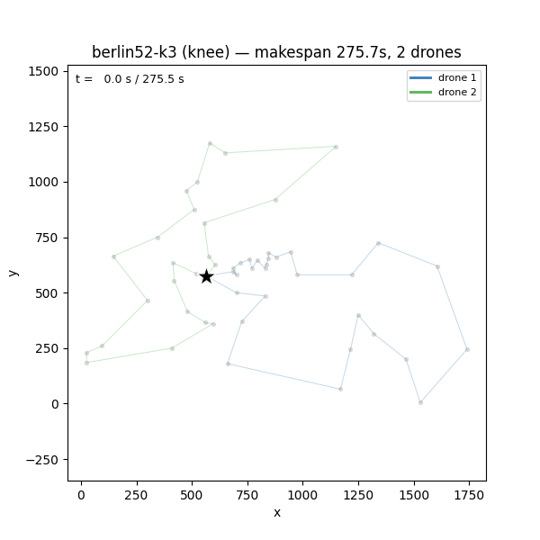
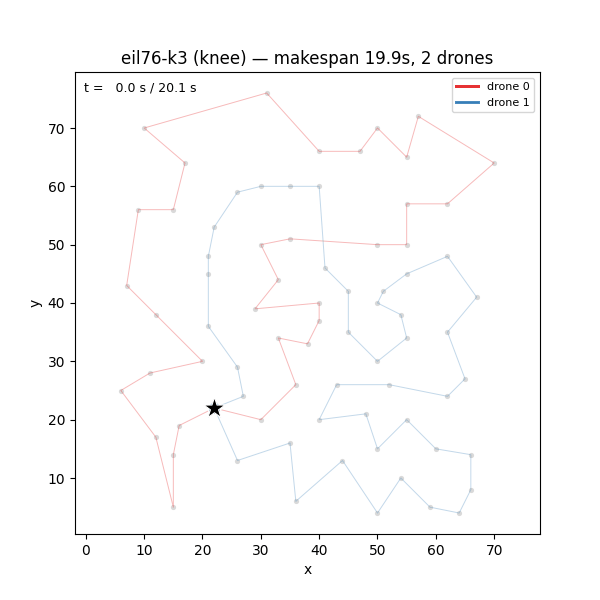
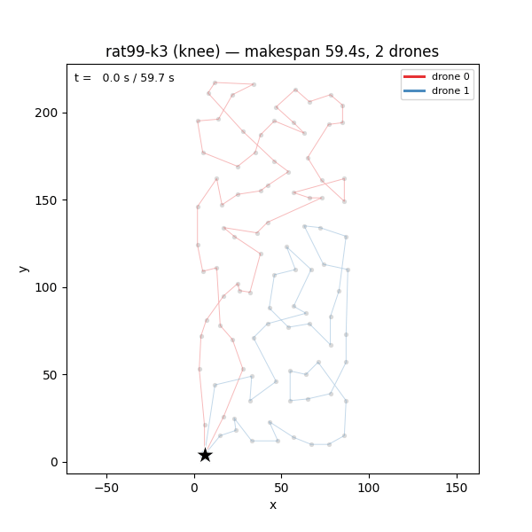

<h1 align="center">Multi-UAV Surveillance Routing</h1>
<p align="center">
  <b>Bi-objective mission planning for drone fleets — NSGA-II vs. MOPSO</b><br>
  <i>Minimize mission time (makespan) and total fleet energy, simultaneously.</i>
</p>

<p align="center">
  
  
  
  
</p>

---

### Example solutions

Each animation decodes one Pareto-optimal solution: three drones depart a shared
depot, partition the points of interest between them, and return. One example per
benchmark instance.

<table>
  <tr>
    <td align="center">
      <br>
      <b>eil51-k3</b> · 50 POIs · 3 drones
    </td>
    <td align="center">
      <br>
      <b>berlin52-k3</b> · 51 POIs · 3 drones
    </td>
  </tr>
  <tr>
    <td align="center">
      <br>
      <b>eil76-k3</b> · 75 POIs · 3 drones
    </td>
    <td align="center">
      <br>
      <b>rat99-k3</b> · 98 POIs · 3 drones
    </td>
  </tr>
</table>

---

## What this is

A **co-equal empirical comparison** of two multi-objective metaheuristics —
**NSGA-II** (a genetic algorithm) and **MOPSO** (particle swarm) — on a bi-objective
multi-UAV surveillance routing problem. A fleet of $K$ homogeneous rotary-wing drones
must cover every point of interest exactly once, trading off two conflicting goals:

- $f_1 = T_\text{makespan}$ — mission completion time, set by the *slowest* drone
  (min–max ⇒ **balance the workload**).
- $f_2 = E_\text{total}$ — total fleet energy under Dorling's linear power model
  $P = \alpha m + \beta$ (min–sum ⇒ **minimize total distance flown**).

Balancing the fleet forces extra depot returns, which costs energy — so the two
objectives genuinely conflict, and *fleet size itself becomes part of the Pareto
trade-off*. Under the constant-mass, constant-velocity assumption, $f_2$ is
proportional to total tour length, making this a physically grounded instance of the
**bi-objective mTSP** (Necula & Breaban mTSPLIB, $K = 3$).

Both algorithms share **one** decoder, fitness function, and distance table, so the
comparison isolates exactly one variable: the optimizer loop and its genotype.

## Getting started

**Requirements:** Python ≥ 3.11 (3.13 pinned for reproducibility) and
[`uv`](https://github.com/astral-sh/uv). All runtime dependencies (`numpy`, `scipy`,
`matplotlib`, `seaborn`, `deap`) are pinned in `requirements.txt`.

**1 — Create the environment and install the package:**

```bash
uv venv --python 3.13 .venv
source .venv/bin/activate
uv pip install -r requirements.txt   # pinned runtime deps
uv pip install -e .                  # install `uav` so `import uav` resolves from src/
```

**2 — Provide the benchmark instances.** Place the four instances in `instances/`:

```
instances/eil51.tsp  instances/berlin52.tsp  instances/eil76.tsp  instances/rat99.tsp
```

**3 — Verify the build.** The suite includes the hand-calculated fitness
check that anchors every downstream number; it must pass before running experiments:

```bash
pytest                               # 106 tests — must be green
```

**4 — Reproduce everything with one command:**

```bash
./run_experiments.sh                 # 4x2x10 sweep -> results/, then figures -> figures/
```

`run_experiments.sh` bootstraps the venv if missing, runs (and *resumes*) the sweep,
and chains `scripts/make_figures.py` — a clean clone to full deliverable in one call.

## Command reference

The build script wraps two independently runnable stages: the **runner** (optimizer
sweep → `results/`) and **make_figures** (results → PDFs + animation). Every reported
figure is `n=10` (10 fixed seeds per instance×algorithm); never quote a single seed.

| Command | What it does |
| --- | --- |
| `./run_experiments.sh` | Full pipeline: 80-run sweep, then all figures. |
| `./run_experiments.sh --no-figures` | Sweep only (skip the figure step). |
| `./run_experiments.sh --instance eil51-k3` | Restrict the sweep to one instance. |
| `./run_experiments.sh --algorithm nsga2` | Run one arm across all instances. |
| `./run_experiments.sh --seed 0,1,2` | Split seeds across sessions (resumable). |
| `python -m uav.experiment.runner` | Run the sweep directly (same filters). |
| `python scripts/make_figures.py` | Render figures from `results/` only (no re-run). |
| `pytest` | Run the 106-test suite. |

**Runner filters** (`python -m uav.experiment.runner`, all repeatable / comma-separated):

- `--instance` — `eil51-k3`, `berlin52-k3`, `eil76-k3`, `rat99-k3` (default: all)
- `--algorithm` — `nsga2`, `mopso` (default: both); `dmopso` is an opt-in
  encoding-diagnostic arm, never run by default
- `--seed` — one or more of the 10 fixed seeds (default: all 10)

**Figure options** (`python scripts/make_figures.py`):

- `--instances eil51-k3 …` — which instances to render (default: all with a complete arm set)
- `--selection {knee,min-makespan,min-energy,max-fleet}` — which Pareto solution to draw (default: `knee`)
- `--animate-instance eil51-k3` — instance to animate; `--no-animation` to skip

```bash
# Examples
python -m uav.experiment.runner --instance eil51-k3 --algorithm nsga2   # one cell
python scripts/make_figures.py --instances rat99-k3 --selection min-makespan
```
